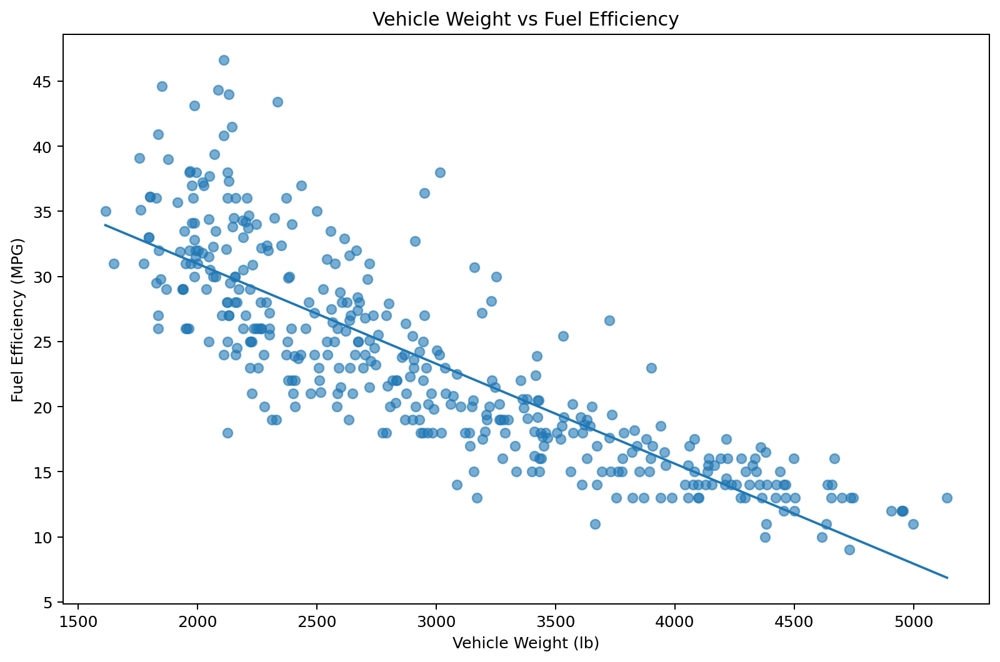
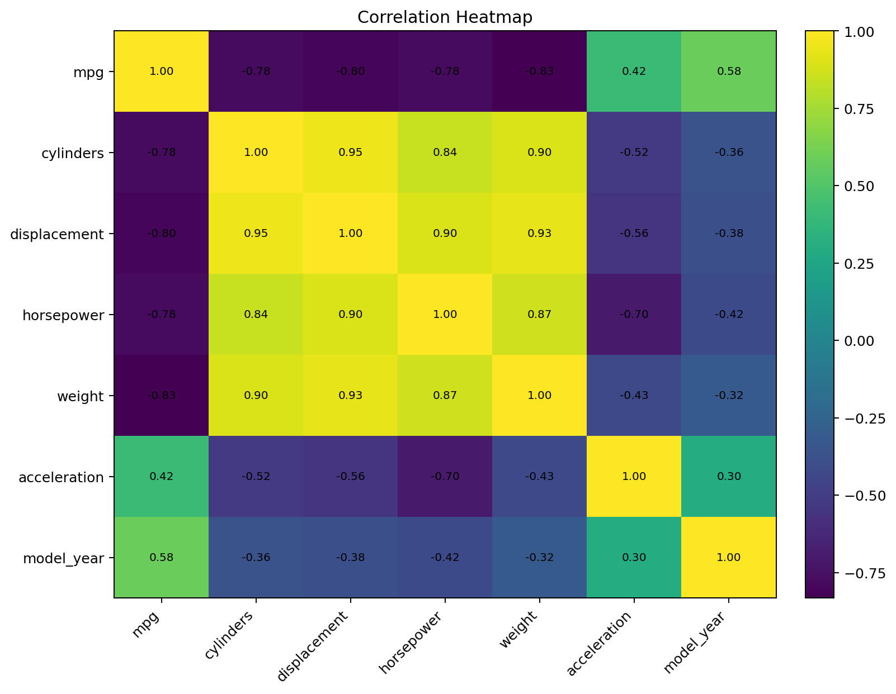
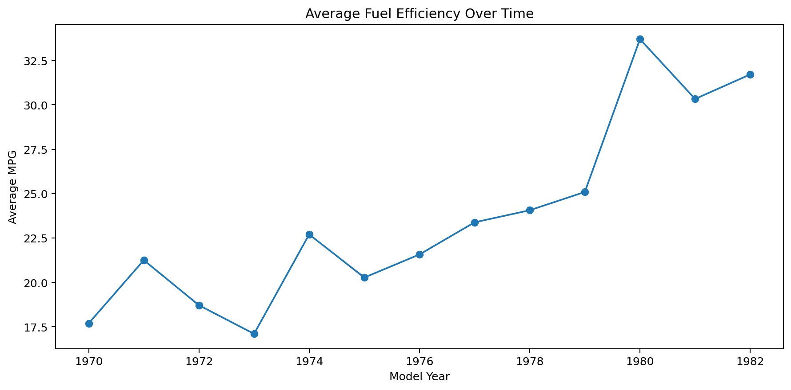
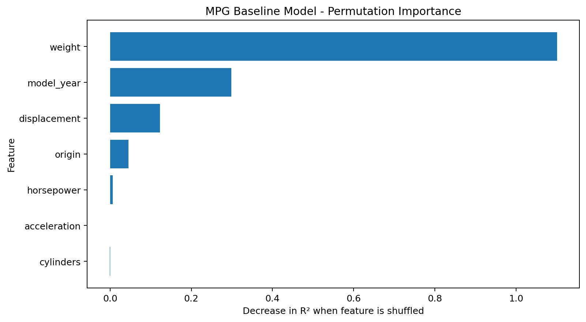

# Automobile Performance & Fuel Efficiency Analysis

An individual data-analysis portfolio project exploring historical automobile performance, fuel efficiency, engine characteristics, model-year trends, manufacturing origin, and unusual acceleration behavior.

## Project Highlights

- **406 vehicles** across model years **1970-1982**
- Average valid fuel efficiency: **23.51 MPG**
- Strong negative relationship between **weight and MPG: -0.83**
- Displacement vs MPG correlation: **-0.80**
- Horsepower vs MPG correlation: **-0.78**
- **Japan** has the highest average MPG at **30.45**
- Average MPG improved by approximately **79.3%** from 1970 to 1982
- Average vehicle weight changed by approximately **-28.7%** over the same period
- **US** has the fastest linear MPG improvement trend at about **1.13 MPG/year**
- **19** acceleration residual outliers identified
- Baseline MPG model: **R² = 0.85**, **MAE = 2.28 MPG**

## Key Visuals

### Weight vs Fuel Efficiency


### Correlation Heatmap


### MPG Trend Over Time


### MPG Baseline Model Importance


## Analytical Workflow

1. Data loading with relative paths
2. Data quality audit and invalid-value detection
3. Conservative cleaning with documented missing-value rules
4. Descriptive statistics and KPI summary
5. Fuel-efficiency analysis by origin and cylinder count
6. Correlation and relationship analysis
7. Historical model-year trend analysis
8. Origin-level MPG improvement trend analysis
9. Acceleration residual outlier detection
10. Interpretable baseline MPG model for analytical validation
11. Export of cleaned data, summary tables, and charts

## Tools

- Python
- Pandas
- NumPy
- Matplotlib
- scikit-learn
- Jupyter Notebook

## Repository Structure

```text
automobile-performance-analysis/
├── Automobile_Performance_Analysis.ipynb
├── automobile_data.csv
├── README.md
├── DATA_DICTIONARY.md
├── requirements.txt
├── .gitignore
├── outputs/
│   ├── cleaned_automobile_data.csv
│   ├── kpi_summary.csv
│   ├── origin_summary.csv
│   ├── cylinder_summary.csv
│   ├── yearly_trends.csv
│   ├── acceleration_residual_outliers.csv
│   ├── mpg_baseline_model_metrics.csv
│   └── charts/
└── report/
    └── Automobile_Performance_Analysis_Report.md
```

## How to Run

```bash
pip install -r requirements.txt
jupyter notebook Automobile_Performance_Analysis.ipynb
```

Run the notebook from top to bottom. It recreates all exported tables and charts.

## Methodology Notes

- Source zeros in `MPG` and `Horsepower` represent unavailable values and are converted to missing values.
- Descriptive analyses do not fabricate replacements for missing measurements.
- The baseline regression model performs median horsepower imputation *inside the model pipeline only*.
- Acceleration is a time-based measure; lower values indicate quicker acceleration.
- Correlations and trend lines describe association, not causation.

## Portfolio Positioning

This project demonstrates end-to-end data analysis: data auditing, cleaning, EDA, KPI design, visual storytelling, trend analysis, anomaly investigation, reproducibility, and concise analytical validation.
